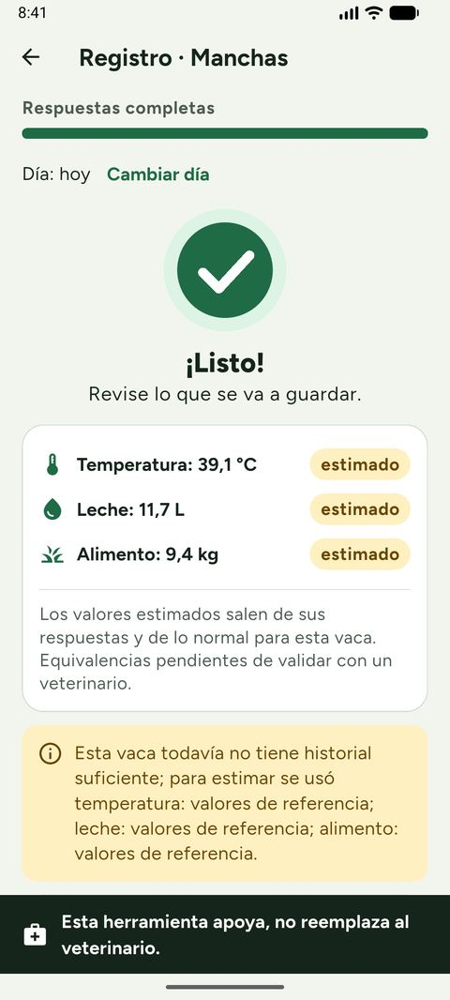
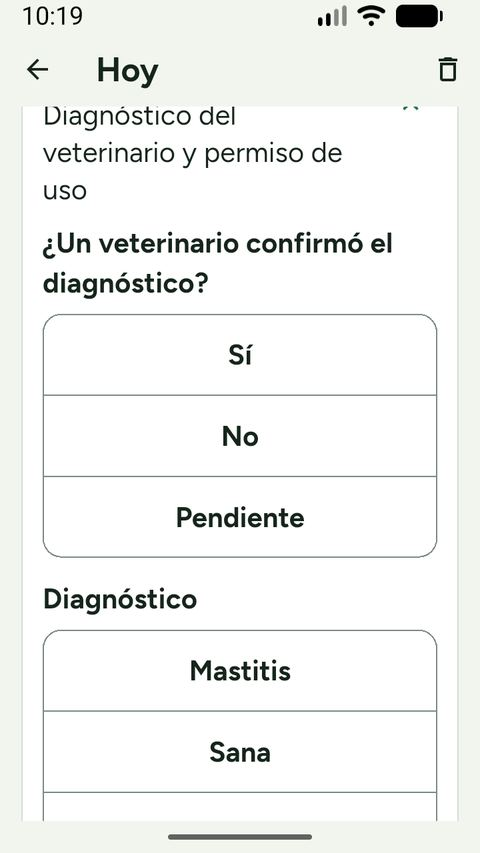
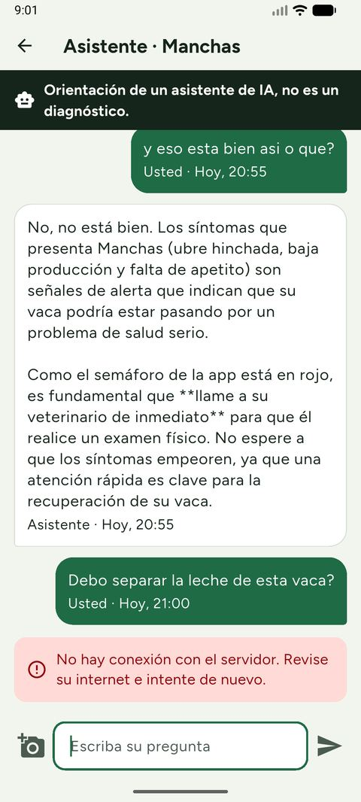
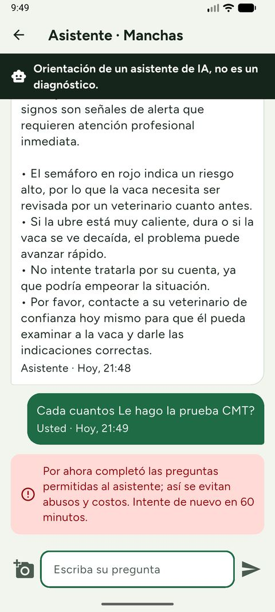
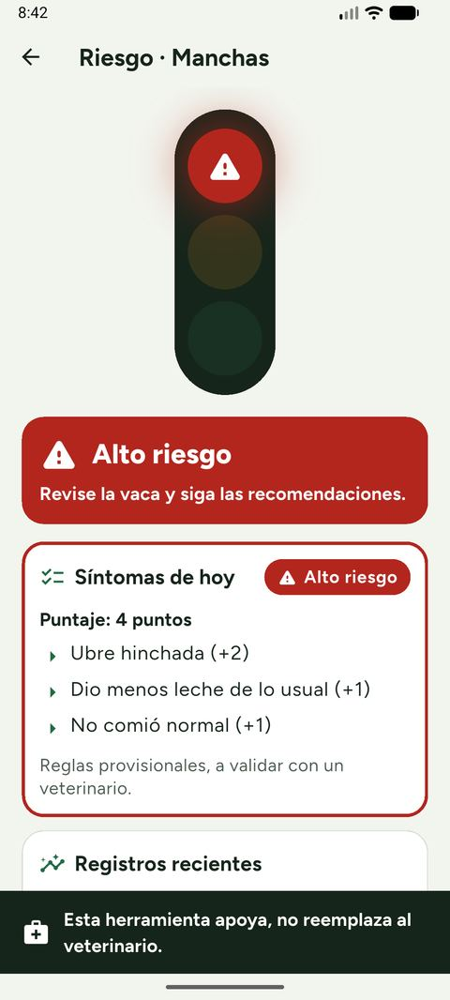
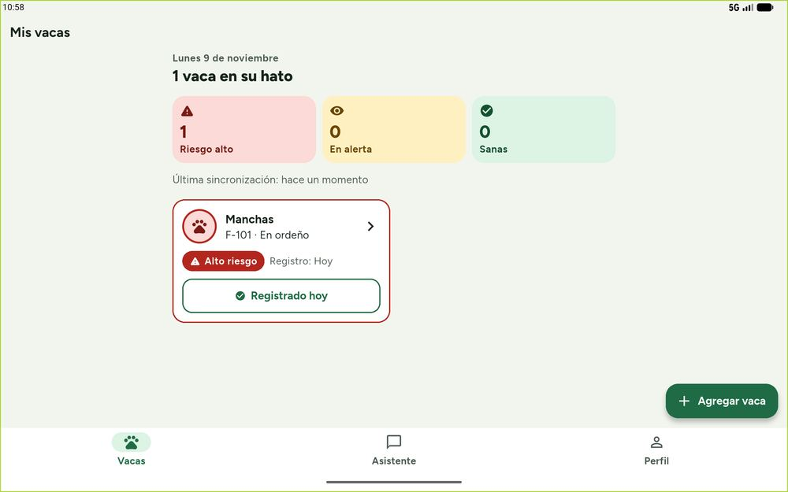
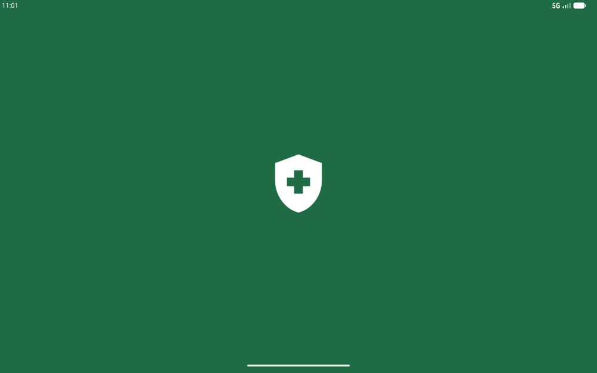

# Pruebas reales en emulador (2026-11-09)

Ronda de 13 pruebas manuales hechas sobre la app compilada, contra el backend real en Docker
(PostgreSQL, correo por Mailpit y la clave real de Gemini), antes de publicar v0.1.0.

## Entorno

| Elemento | Valor |
|---|---|
| Teléfono | AVD `AgroVet_Phone` (1080 × 2400) |
| Pantalla pequeña | 360 × 640 dp con la letra del sistema al 130 % |
| Tableta | AVD `Pixel_Tablet` (2560 × 1600) |
| Backend | `docker compose` local (Spring Boot + PostgreSQL 15 + Mailpit), app con `API_BASE_URL=http://10.0.2.2:8080` |
| Datos | cuenta y vaca de ejemplo (Manchas, F-101); sin datos de personas reales |
| Rama probada | `develop` con las ramas del asistente y de la CNN integradas |

## Resultados

| # | Prueba | Resultado | Problema encontrado → corrección | Bug | Commit |
|---|---|---|---|---|---|
| 1 | Registro con código (Mailpit) e ingreso | ✅ El código de 6 dígitos llega y la cuenta entra | — | — | — |
| 2 | Inicio con la lista vacía | ✅ con ajuste | «Sin sincronizar aún» flotaba en medio de la pantalla → va arriba | #66 | `b70fbb5` |
| 3 | «Última sincronización» | ❌ → corregido | Se quedaba en «hace un momento» → se actualiza cada minuto («hace 52 min») | #67 | `b70fbb5` |
| 4 | Crear vaca | ✅ F-101 llegó a PostgreSQL | — | — | — |
| 5 | Registro diario y semáforo | ✅ con ajuste | Alto riesgo por síntomas (puntaje 4). «¿Cómo ves…?» → «¿Cómo ve…?» y «valores de referencia» ya no se repite 3 veces | #68 | `ea3a058` |
| 6 | Foto con cámara virtual y galería | ✅ con ajuste | Las 2 fotos subieron al servidor. El lector de pantalla decía «Foto del Hoy» → «Foto: hoy» | #69 | `ea3a058` |
| 7 | Formulario de investigación de la foto | ✅ | Restaurado, plegado y opcional | — | `4696cea` |
| 8 | Chat con el asistente: 3 preguntas | ❌ → corregido | Las respuestas salían con `**` y `*` → texto plano. Las 3 respuestas fueron adecuadas y la de dosis se negó a recetar | #70 | `b5dee4d` |
| 9 | Asistente sin internet | ✅ con ajuste | Aparece «Sin internet: el asistente no está disponible…», pero los consejos quedaban fuera de la pantalla → la pantalla baja a ellos | #71 | `b5dee4d` |
| 10 | Backend caído | ❌ → corregido | Decía «Revise su internet» aunque había señal → «No pudimos comunicarnos con el servidor de AgroVet. Puede ser la señal o que el servidor no esté disponible…» | #72 | `4129389` |
| 11 | Límite del asistente (429 simulado, 1 por hora) | ⚠️ → corregido | Decía «54 minuto(s)» → «Por ahora completó las preguntas permitidas al asistente… Intente de nuevo en 60 minutos.» | #73 | `4129389` |
| 12 | Letra al 130 % en 360 × 640 dp | ❌ → corregido | «Pendien-te» partido, «Notas del diagnóstico (…» y «Hoy» de la gráfica cortados → corregidos; los selectores medían 48 dp → ahora ≥ 56 dp. El logcat no muestra desbordes | #74, #75 | `c9ad614` |
| 13 | Tableta 2560 × 1600 | ✅ | Dos columnas, nada cortado. Con la misma cuenta, la vaca del teléfono no aparecía: la app solo subía datos → se agregó la restauración desde el servidor | #63 | `4800bd2`, `095b3c8` |

**Resumen:** 13 pruebas; 10 problemas corregidos (#66–#75), cada uno con su commit. Además, la
prueba 13 dejó una funcionalidad nueva (#63). Después de los arreglos: `flutter test` 183/183,
`./mvnw verify` 104 sin fallas (1 omitida) y pytest 80. Con la restauración ya integrada, el CI de
v0.1.0 corrió 188 pruebas de la app.

### Verificaciones posteriores en la tableta

- **Restauración (#63):** se borraron los datos de la app y se entró con la cuenta de ejemplo.
  Apareció Manchas (F-101) con el semáforo en Alto riesgo, su registro y sus gráficas.
- **Ícono y arranque (#64):** el cajón de apps muestra el ícono de AgroVet y el arranque sale verde
  con el escudo.

### Prueba en vivo de Gemini

`GeminiLiveTest` (backend), corrida a mano con la clave real: 1/1 en 13,9 s, con el modelo
`gemini-3.1-flash-lite`. En el CI se omite porque necesita la clave.

## Capturas

Se eligieron capturas sin correos, claves ni contenido del portapapeles (dos capturas de la tableta
que mostraban texto del portapapeles se borraron el mismo día). Están reducidas para el repositorio.

| Antes del arreglo | Después del arreglo |
|---|---|
|  Prueba 5: «valores de referencia» tres veces (#68). |  Prueba 12: «Pendiente» sin partir y selectores de 56 dp (#74, #75). |
|  Pruebas 8 y 10: `**` a la vista y «Revise su internet» con el servidor caído (#70, #72). |  Prueba 11: mensaje claro del límite y respuesta en texto plano (#73, #70). |

| Semáforo por síntomas (prueba 5) | Tableta restaurada (prueba 13 → #63) | Arranque (#64) |
|---|---|---|
|  |  |  |

## Límites de esta ronda

- Fueron emuladores, no celulares físicos: falta la prueba en un celular de gama baja real y a pleno
  sol (#17), y con la cámara real (prueba de campo planificada, #93).
- La tarea de WorkManager no se lanzó sola en 20 minutos en una prueba anterior (Android la agrupa);
  se forzó con `cmd jobscheduler run` y terminó en SUCCESS.
- El backend corría en el equipo de desarrollo; el despliegue con HTTPS está planificado (#88).
