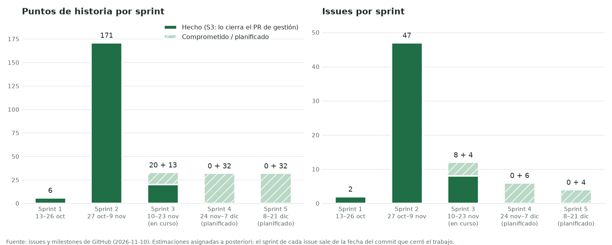

# Sprints, cronograma y revisiones

Sprints de dos semanas contados desde el primer commit (2026-10-13). Los sprints 1 y 2 se
**reconstruyeron del historial**: cada issue cerrado va al sprint en que se terminó el trabajo,
según la fecha de su commit. Los sprints 4 y 5 son **planificados**.

Cada sprint es un milestone en GitHub y una iteración del campo «Sprint» en el Project.

| Sprint | Fechas | Estado | Milestone | Issues (hechos + pendientes) | Puntos (hechos + pendientes) |
|---|---|---|---|---|---|
| Sprint 1 | 2026-10-13 a 2026-10-26 | Cerrado | [Sprint 1](https://github.com/Pipemora1324/Agrovet/milestone/1?closed=1) | 2 + 0 | 6 + 0 |
| Sprint 2 | 2026-10-27 a 2026-11-09 | Cerrado | [Sprint 2](https://github.com/Pipemora1324/Agrovet/milestone/2?closed=1) | 47 + 0 | 171 + 0 |
| Sprint 3 | 2026-11-10 a 2026-11-23 | En curso | [Sprint 3](https://github.com/Pipemora1324/Agrovet/milestone/3) | 8 + 4 | 20 + 13 |
| Sprint 4 | 2026-11-24 a 2026-12-07 | Planificado | [Sprint 4](https://github.com/Pipemora1324/Agrovet/milestone/4) | 0 + 6 | 0 + 32 |
| Sprint 5 | 2026-12-08 a 2026-12-21 | Planificado | [Sprint 5](https://github.com/Pipemora1324/Agrovet/milestone/5) | 0 + 4 | 0 + 32 |

En el sprint 3, los 8 «hechos» son los issues de gestión y evidencias que cierra el pull request de
esta entrega. Las épicas y las HU no llevan sprint, porque abarcan varios.

## Cómo leer estas cifras

- **Las estimaciones se asignaron a posteriori** (2026-11-10), según el tamaño real de cada cambio.
  Sirven para comparar sprints, no como una predicción hecha antes.
- **Muchos issues se registraron después del trabajo** (etiqueta `registro-retroactivo`): tareas y
  bugs que antes solo estaban en los commits. Su fecha de creación es el 2026-11-10, pero su sprint y
  sus fechas salen del commit que los resolvió, citado en cada issue.
- El trabajo se concentró en pocos días: 13 y 25 de octubre (sprint 1), y 27 de octubre, 8 y 9 de
  noviembre (sprint 2). Es un proyecto de una sola persona, y eso se nota en la velocidad.

## Sprint 1 · 2026-10-13 a 2026-10-26

**Objetivo:** preparar el repositorio y la integración continua antes de escribir el producto.

**Qué se hizo:** 18 commits en dos días de trabajo.
- 13-oct: estructura por módulo, README, guía de contribución, plantillas, CI de `ml`, `backend` y
  `mobile`, y script de issues (#54).
- 25-oct: actions fijadas por SHA, CI limitado a `main`/`develop` con permisos de solo lectura,
  Dependabot, `dependency-review` y `.gitignore` con secretos y datasets (#55).

**Revisión:**
- *Qué salió mal:* `dependency-review` fallaba porque el Dependency graph del repositorio estaba
  apagado; se activó en el sprint 2. Entre el 13 y el 25 de octubre no hubo commits.
- *Qué se mejoró:* la seguridad del CI quedó definida desde el inicio (SHA, permisos mínimos,
  revisión de dependencias), antes de tener código.

## Sprint 2 · 2026-10-27 a 2026-11-09

**Objetivo:** construir el producto completo y llegar a una primera versión entregable.

**Qué se hizo:** 148 commits y 45 integraciones a `develop`, en tres días de trabajo.
- **27-oct:** fases B a E. Dataset sintético, LSTM y TFLite (#12, #13, #15); backend con autenticación
  propia, vacas, historial y sincronización (#1, #2, #4, #9, #18, #23); app Flutter con base cifrada,
  captura, inferencia y semáforo (#3, #5, #6, #16, #19, #24); sincronización en segundo plano (#10),
  alertas atendidas (#7) y APK de 12,5 MB (#21). Primera integración a `main` (`b2b96f8`). Los issues
  de requisitos se crearon ese mismo día con `scripts/create_issues.sh` y se cerraron con evidencia.
- **8-nov:** etapa de producto usable. Verificación de correo (#28), perfil y consentimiento (#29),
  registro flexible con puntaje por síntomas (#30), fotos (#31), asistente con IA (#32), tema
  centralizado y rediseño (#56), registro por preguntas (#57), preparación del despliegue (#59) y
  diagramas (#60).
- **9-nov:** CNN de ubre con un dataset público, apagada por sesgo (#62); 13 pruebas reales en
  emulador con 10 problemas corregidos (#66–#75, [informe](pruebas/emulador.md)); restauración desde el
  servidor (#63); ícono (#64); `develop` → `main` y etiqueta **v0.1.0** con el CI en verde (#65).

**Revisión (hechos del historial):**
- *Qué salió mal:*
  - La primera exportación a TFLite devolvía NaN por operaciones `VAR_HANDLE` (#79).
  - Un reemplazo masivo de texto rompió los imports de la app dos veces.
  - `bloc_test` chocaba con `build_runner` y se sacó.
  - `sqlcipher_flutter_libs` ya no tiene soporte, así que se cambió a hooks con el código fuente de SQLCipher.
  - Android agrupó la tarea de WorkManager y no la lanzó en 20 minutos; se forzó para comprobarla.
  - Windows (Control de aplicaciones inteligente) bloqueó `sqlcipher.dll` y 54 pruebas locales fallaron por esa causa; en el CI de Linux pasaban.
  - El emulador original se colgó con el 93 % del almacenamiento lleno.
  - Dos capturas de la tableta mostraban texto del portapapeles y se borraron.
  - La tolerancia de la paridad de la CNN se subió de 0,01 a 0,03 después de ver el resultado; quedó declarado.
- *Qué se mejoró:*
  - Una prueba de arquitectura impide estilos fuera del tema.
  - El CI falla si un APK pasa de 15 MB.
  - Las actualizaciones de Dependabot se aplican en commit propio y las versiones mayores quedan pospuestas (#61).
  - Cada problema del emulador terminó con su corrección y, cuando era posible, una prueba automática.
- *Qué cambiar:*
  - El trabajo se hizo en ráfagas y sin pull requests.
  - Los issues se escribieron al final.
  - Nada obligaba a pasar el CI antes de integrar.
  - Estos tres puntos son los objetivos de proceso del sprint 3.

## Sprint 3 · 2026-11-10 a 2026-11-23 (en curso)

**Objetivo:** gestión del proyecto y evidencias de pruebas para la entrega; dejar listo el
despliegue con HTTPS y la protección de ramas.

**Comprometido:**
- Plantillas de issues y PR (#86).
- Backlog, sprints, Project y gráfica de velocidad (#87).
- Evidencias de pruebas y trazabilidad (#80–#85).
- Despliegue en una VPS con HTTPS (#88).
- Actualizaciones de Dependabot #33 y #34 (#89).
- Datos del responsable en el aviso de privacidad (#90).
- Protección de ramas con checks obligatorios (#22).

**Avance al 2026-11-10:** primer pull request del repositorio, con las plantillas, el backlog y las
evidencias; lo demás está en «Listo».

## Sprint 4 · 2026-11-24 a 2026-12-07 (planificado)

**Objetivo:** validar en condiciones reales.
- Prueba de campo con ganaderos de Nariño (#93) y escala SUS (#94).
- Revisión veterinaria del puntaje por síntomas (#92).
- Celular de gama baja y tableta reales (#17).
- Recuperar las fotos al restaurar (#91).
- Recolectar fotos confirmadas para la CNN (#95).

## Sprint 5 · 2026-12-08 a 2026-12-21 (planificado)

**Objetivo:** cerrar la tesis.
- Validar la CNN si hay fotos (#11).
- Mejora opcional del LSTM con máscara y datos reales (#96).
- Resultados y conclusiones (#97).
- Sustentación y versión final en `main` (#98).

> Las fechas de los sprints 4 y 5 son una propuesta de cronograma y se ajustan en cada revisión
> según el calendario académico.
