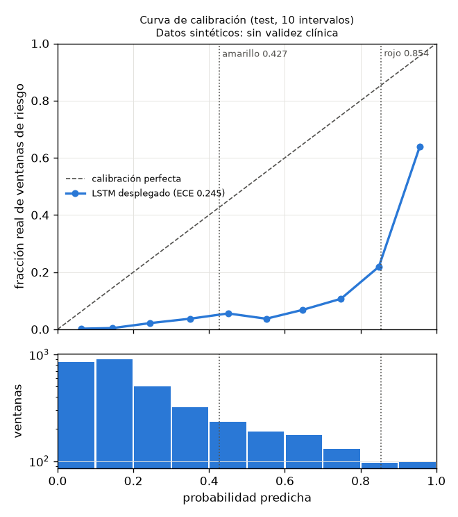
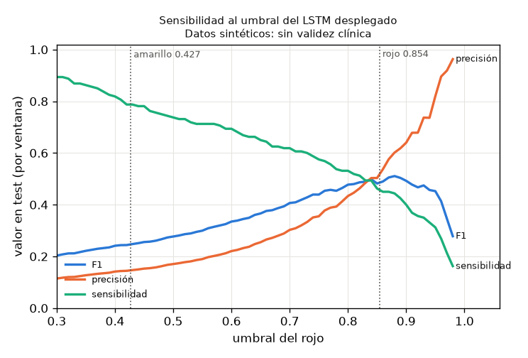

# ml — Modelo de alerta temprana

Generación del dataset, entrenamiento del modelo LSTM y exportación a TensorFlow Lite para la app.

> **Aviso sobre los datos.** Por ahora el modelo se entrena con un **dataset sintético**. Sus
> métricas sirven para comprobar que el pipeline funciona de punta a punta y **no validan la
> hipótesis del proyecto (F1 ≥ 0,80)**. El generador no se ajusta para mejorar las métricas.
> Cuando haya registros reales de fincas se reentrena con este mismo pipeline.

## Requisitos

Python 3.13.

```bash
cd ml
python -m venv .venv
.venv\Scripts\activate          # Windows  (Linux/Mac: source .venv/bin/activate)
pip install -r requirements.txt
```

## Pipeline

```bash
python src/generate_dataset.py      # data/daily_records.csv (no se versiona)
python src/train_lstm.py            # models/lstm.keras + reports/metrics.json y gráficas
python src/export_tflite.py         # models/mastitis_lstm.tflite + models/model_config.json
python src/export_test_vectors.py   # models/test_vectors.json
pytest --cov                        # pruebas con cobertura
ruff check src tests                # estilo
mypy                                # tipos
```

### Dependencias fijadas por hash

El CI no instala desde `requirements.txt` sino desde dos archivos generados a partir de él, con
**todas** las dependencias fijadas por versión y hash, y solo wheels
(`pip install --only-binary :all: --require-hashes`):

- `requirements.lock`: todo `ml` (jobs `ml` y `calidad`).
- `requirements-mutmut.lock`: solo numpy, pandas, scikit-learn, pytest y mutmut (job de mutación,
  sin TensorFlow).

Si cambia una versión en `requirements.txt` (por ejemplo, un PR de Dependabot), hay que regenerarlos.
`tests/test_requirements_lock.py` falla mientras no coincidan. Se generan para el runner de Linux con
[uv](https://docs.astral.sh/uv/):

```bash
cd ml
uv pip compile requirements.txt --generate-hashes --python-version 3.13 \
  --python-platform x86_64-manylinux_2_28 --only-binary :all: --no-header -o requirements.lock
grep -E '^(numpy|pandas|scikit-learn|pytest|mutmut)==' requirements.txt | \
  uv pip compile - --generate-hashes --python-version 3.13 \
  --python-platform x86_64-manylinux_2_28 --only-binary :all: --no-header -o requirements-mutmut.lock
```

Las pruebas de mutación (`mutmut`) solo corren en Linux o WSL; ver
[docs/gestion/pruebas/calidad.md](../docs/gestion/pruebas/calidad.md).

| Archivo | Qué hace |
|---|---|
| `src/generate_dataset.py` | Dataset sintético por vaca y día. |
| `src/preprocess.py` | Limpieza, ventanas de 14 días y normalización. La app replica esta lógica en Dart. |
| `src/train_lstm.py` | Partición por vaca, entrenamiento, umbral y métricas. |
| `src/export_tflite.py` | Conversión a TFLite, comparación con Keras y `model_config.json`. |
| `src/export_test_vectors.py` | Casos de prueba para verificar la app contra Python. |
| `src/lstm_evaluation.py` | Líneas base, degradaciones, métricas con IC por vaca, umbrales e importancia de variables (sin TensorFlow). |
| `src/evaluate_lstm.py` | Evalúa el TFLite desplegado con todo lo anterior (datos sintéticos). |

## Dataset sintético

- 600 vacas, 60 días, semilla fija (42). El 35 % (210 vacas) desarrolla mastitis clínica entre los días 20 y 56.
- Cada vaca tiene su propia línea base de temperatura, leche y alimento, con ruido diario y una leve
  caída de la producción a lo largo de la lactancia.
- **Fase subclínica** de 5 a 7 días antes del inicio clínico: la temperatura sube y la leche y el
  alimento bajan de forma progresiva, con intensidad proporcional a la severidad de cada caso.
- **Factores de confusión** que producen señales parecidas sin enfermedad:
  - celo cada ~21 días (el 30 % de las vacas no cicla, como si estuviera preñada);
  - rachas de estrés calórico compartidas por todo el hato.
- **Registros erróneos** (~2 %): decimal corrido, temperatura en Fahrenheit, un cero de más en la
  leche, alimento en cero o dato vacío.
- `days_to_onset` está vacío en vacas sanas y es negativo después del inicio clínico.

## Ventanas y normalización

- Ventanas de 14 días. Etiqueta positiva si el inicio clínico ocurre entre 1 y 5 días después del
  último día. Se descartan las ventanas que terminan en el inicio clínico o después.
- Un valor vacío o fuera de rango se trata como faltante y toma el último valor válido anterior.
  Si una variable tiene menos de 10 días válidos, la ventana no se evalúa.
  Rangos válidos: temperatura 35–42 °C, leche 0,5–45 L y alimento 0,5–35 kg.
- La base es la media de los primeros 7 días. Temperatura: `(t − base) / 0,5`.
  Leche y alimento: `(x / base − 1) / 0,1`.

## Modelo

LSTM(32) → Dropout(0,3) → Dense(16, relu) → Dense(1, sigmoide). Partición 70/15/15 por vaca,
estratificada. Pesos de clase balanceados y parada temprana sobre el AUC de validación. El umbral
es el que maximiza F1 en validación.

## Resultados actuales (dataset sintético)

> Estas cifras vienen de **datos sintéticos** y **no validan la hipótesis F1 ≥ 0,80**. Con estos
> datos el modelo **no** alcanza esa meta; se reportan tal como salieron.

Set de test: 90 vacas (32 enferman), 3514 ventanas, 160 positivas. Detalle en `reports/metrics.json`.

| Métrica (test) | Valor |
|---|---|
| F1 | 0,492 |
| Precisión | 0,525 |
| Sensibilidad | 0,463 |
| AUC ROC | 0,891 |
| AUC precisión-sensibilidad | 0,521 |
| Matriz de confusión | VN 3287 · FP 67 · FN 86 · VP 74 |
| Vacas enfermas con alerta 1–5 días antes | 30 de 32 (93,8 %) |
| Anticipación mediana de la primera alerta | 2 días |
| Vacas sanas con al menos una alerta roja | 31 de 58 (53,4 %) |
| Ventanas de vacas sanas en rojo | 2,0 % |

Umbral (máximo F1 en validación): **0,854**. Es alto porque los pesos de clase desplazan las
probabilidades hacia arriba; no debe leerse como una probabilidad calibrada.

Exportación a TFLite (`reports/export.json`): 62,7 KB, solo operaciones nativas de TFLite. Sobre las
3514 ventanas de test, la diferencia máxima entre Keras y TFLite es 3,6 × 10⁻⁷ y ambos toman la
misma decisión en el 100 % de los casos. Para exportar, el LSTM se desenrolla (14 pasos fijos):
es el mismo cálculo con los mismos pesos, sin bucles en el grafo.

## Semáforo

| Color | Probabilidad | Lectura |
|---|---|---|
| Verde | < 0,427 | Sin señales de riesgo |
| Amarillo | 0,427 a < 0,854 | Alerta temprana: vigilar y repetir el registro |
| Rojo | ≥ 0,854 | Alto riesgo: consultar al veterinario |

Decisión: se mantiene la regla del plan (amarillo desde la mitad del umbral). Se compararon en
validación otros cortes para el amarillo (sensibilidad del 90 %, 80 % y 70 %) y ninguno separa bien
a las vacas sanas. Con la regla elegida, en validación el 85,8 % de las ventanas de riesgo queda en
amarillo o rojo, a cambio de que el 21,5 % de las ventanas sanas quede en amarillo. Para un aviso
temprano se prefiere que el amarillo sea sensible y reservar el rojo para el umbral de F1. En test,
las ventanas sanas quedan 77,7 % verde, 20,3 % amarillo y 2,0 % rojo; las que terminan 1–5 días
antes del inicio, 21,3 % verde, 32,5 % amarillo y 46,3 % rojo.

## Evaluación del LSTM desplegado (datos sintéticos)

> **Todo lo de esta sección sale de datos SINTÉTICOS.** Muestra cómo se comporta el modelo y dónde
> falla dentro del simulador; **no tiene validez clínica** y no valida la hipótesis F1 ≥ 0,80.

```bash
python src/evaluate_lstm.py   # reports/lstm_evaluation.json, lstm_calibracion.png y lstm_umbrales.png (~15 min)
```

- **Se evalúa el modelo de la app, sin cambiarlo.** Se usan `models/mastitis_lstm.tflite` (su SHA-256
  coincide con `model_config.json`) y sus umbrales 0,854394 y 0,427197. No se reentrena. Sobre el
  test reproduce exactamente las cifras de `reports/metrics.json` (F1 0,492, AUC 0,891).
- **Datos:** el dataset por defecto de `generate_dataset.py` y la misma partición 70/15/15 por vaca
  de `train_lstm.py`. Test: 90 vacas, 3514 ventanas, 160 de riesgo.
- **Intervalos de confianza:** IC 95 % por bootstrap de **vacas** (2000 remuestreos). Las ventanas de
  una vaca no son independientes. Las diferencias contra el LSTM son pareadas, sobre las mismas
  muestras.
- **Generador:** `generate_dataset.py` ganó parámetros de finca (medias de producción, escala del
  ruido, del estrés calórico y de la severidad). Con los valores por defecto da exactamente los
  mismos datos que antes (`test_default_farm_parameters_reproduce_the_training_data`).

### 1. Líneas base (test, mismo umbral por máximo F1 en validación)

| Modelo | F1 (IC 95 %) | AUC (IC 95 %) | Sensibilidad (IC 95 %) | Precisión | Vacas enfermas avisadas 1–5 d | Vacas sanas con alguna alerta |
|---|---|---|---|---|---|---|
| **LSTM desplegado** | **0,49 (0,40–0,57)** | **0,89 (0,87–0,91)** | 0,46 (0,38–0,55) | 0,53 | 30/32 | 31/58 |
| Umbral de temperatura (°C sobre la base) | 0,33 (0,24–0,40) | 0,83 (0,79–0,86) | 0,36 (0,28–0,45) | 0,30 | 26/32 | 49/58 |
| Regresión logística (42 valores) | 0,43 (0,34–0,50) | 0,86 (0,83–0,89) | 0,43 (0,35–0,50) | 0,43 | 29/32 | 43/58 |
| Random forest (42 valores) | 0,44 (0,34–0,52) | 0,87 (0,84–0,90) | 0,33 (0,25–0,41) | 0,65 | 25/32 | 18/58 |

Diferencia pareada con el LSTM (IC 95 %):

| Modelo | ΔF1 | ΔAUC | ΔSensibilidad |
|---|---|---|---|
| Umbral de temperatura | −0,23 a −0,09 | −0,10 a −0,03 | −0,18 a −0,03 |
| Regresión logística | −0,12 a −0,01 | −0,05 a −0,01 | −0,09 a +0,02 |
| Random forest | −0,11 a +0,01 | −0,04 a −0,01 | −0,19 a −0,08 |

**Lectura:**
- El LSTM supera con claridad al umbral de temperatura: la leche y el alimento aportan información.
- Frente a la regresión logística y al random forest la ventaja es chica. En AUC es significativa
  (unos 0,02–0,03). En F1, contra el random forest, no lo es.
- El random forest con su umbral alerta a menos vacas sanas (18/58), pero avisa a tiempo a menos
  enfermas (25/32).
- Las líneas base usan hiperparámetros fijos, sin búsqueda.

### 2. Robustez del LSTM (tabla de degradación)

Las degradaciones se aplican a las ventanas **crudas** del test, antes del preprocesamiento que
replica la app. El ruido se mide en múltiplos del ruido diario del generador: 0,15 °C, 5 % de la
leche y 6 % del alimento.

Las degradaciones al azar son la media de 5 repeticiones. **Cobertura** es la fracción de ventanas
que el preprocesamiento acepta: hacen falta ≥ 10 días válidos por variable, y si no, la app no da
color. **Sens. total** cuenta como no detectadas las ventanas de riesgo sin evaluar.

| Degradación | Nivel | Cobertura | F1 | Sensibilidad | Sens. total | Especificidad | AUC |
|---|---|---|---|---|---|---|---|
| Sin degradar | — | 1,00 | 0,49 | 0,46 | 0,46 | 0,980 | 0,89 |
| Ruido gaussiano | × 0,5 | 1,00 | 0,46 | 0,47 | 0,47 | 0,974 | 0,88 |
| | × 1 | 1,00 | 0,39 | 0,47 | 0,47 | 0,955 | 0,85 |
| | × 2 | 1,00 | 0,26 | 0,47 | 0,47 | 0,900 | 0,78 |
| | × 3 | 1,00 | 0,20 | 0,42 | 0,42 | 0,866 | 0,73 |
| Datos faltantes (celdas al azar) | 10 % | 0,96 | 0,45 | 0,44 | 0,41 | 0,977 | 0,88 |
| | 20 % | 0,63 | 0,43 | 0,43 | 0,27 | 0,974 | 0,86 |
| | 30 % | **0,18** | 0,45 | 0,43 | **0,09** | 0,972 | 0,85 |
| Días completos sin registro | 10 % | 0,98 | 0,47 | 0,44 | 0,43 | 0,979 | 0,88 |
| | 20 % | 0,83 | 0,42 | 0,42 | 0,34 | 0,972 | 0,86 |
| | 30 % | 0,54 | 0,41 | 0,41 | 0,22 | 0,972 | 0,85 |
| Faltan los primeros días (historia corta) | 1 d | 1,00 | 0,48 | 0,46 | 0,46 | 0,979 | 0,89 |
| | 2 d | 1,00 | 0,47 | 0,44 | 0,44 | 0,980 | 0,89 |
| | 4 d | 0,80 | 0,44 | 0,38 | 0,31 | 0,982 | 0,87 |
| **Faltan los últimos días** | 1 d | 1,00 | 0,30 | 0,31 | 0,31 | 0,962 | 0,79 |
| | 2 d | 1,00 | **0,16** | 0,17 | 0,17 | 0,954 | 0,68 |
| | 4 d | 0,79 | **0,05** | 0,06 | 0,04 | 0,934 | 0,52 |

La tabla completa, con 3 días y los rangos entre repeticiones, está en `reports/lstm_evaluation.json`.

**Lectura:**
- **El punto más débil son los días recientes sin registrar.** El preprocesamiento rellena con el
  último valor válido y borra justo la subida de temperatura y la caída de leche que anuncian la
  mastitis.
  - Con 2 días sin registro el F1 baja de 0,49 a 0,16; con 4 días el AUC queda en 0,52, como el azar.
  - Esas ventanas se siguen aceptando (cobertura 1,00 hasta 3 días), así que se les da un color
    aunque falten los días recientes.
- **Con datos faltantes al azar, la ventana se descarta antes de que el modelo se equivoque.**
  - Con 30 % de celdas vacías solo se evalúa el 18 % de las ventanas.
  - Las ventanas que se evalúan mantienen F1 y AUC casi iguales.
- **El ruido de medición** baja sobre todo la precisión: la sensibilidad se mantiene y aparecen más
  falsas alarmas. Con el doble del ruido normal el F1 cae a la mitad.

### Desplazamiento de distribución: otras fincas simuladas

Cada finca es un dataset nuevo de 600 vacas (otra semilla) que ningún modelo vio. Los umbrales son
los del entrenamiento.

| Finca | Cambio | F1 LSTM (IC 95 %) | AUC LSTM (IC 95 %) | Sens. | Vacas sanas con alerta | Mejor línea base (AUC) |
|---|---|---|---|---|---|---|
| Misma finca, otras vacas | ninguno (control) | 0,51 (0,48–0,54) | 0,89 (0,87–0,90) | 0,44 | 44 % | RF 0,89 |
| Alta producción | leche 24 L, alimento 17 kg | 0,52 (0,49–0,55) | 0,89 (0,88–0,90) | 0,46 | 44 % | RL 0,89 |
| Clima cálido | estrés calórico × 2 | 0,36 (0,32–0,39) | 0,87 (0,85–0,88) | 0,53 | **90 %** | RL/RF 0,83 |
| Registros ruidosos | ruido × 2, 6 % de errores | 0,28 (0,25–0,31) | 0,79 (0,77–0,81) | 0,49 | **96 %** | RL 0,80 |
| Subclínica corta y leve | 3–5 días, severidad 0,3–0,9 | 0,23 (0,20–0,26) | 0,73 (0,71–0,75) | 0,16 | 27 % | RL 0,73 |
| Otra finca (todo junto, base 38,8 °C) | combinado | **0,13 (0,11–0,15)** | **0,63 (0,60–0,65)** | 0,23 | **99 %** | RL 0,63 |

**Lectura:**
- **Control:** con otras vacas de la misma finca simulada el resultado es el mismo que en test
  (F1 0,51, AUC 0,89). El test no tuvo suerte.
- **Escala de producción:** no afecta, porque la normalización es relativa a la base de cada vaca.
- **Clima y registros ruidosos:** el AUC baja poco, pero con el umbral fijo casi todas las vacas
  sanas reciben alguna alerta roja. **El umbral no se traslada de una finca a otra.**
- **Enfermedad más corta o más leve:** la señal aparece tarde y el modelo avisa a pocas vacas.
- **Todo junto:** el modelo queda cerca del azar.
- Con registros ruidosos, enfermedad leve o todo combinado, la regresión logística iguala al LSTM
  (el IC de la diferencia de AUC incluye 0). La ventaja de la red se sostiene solo cerca de la
  distribución con la que se entrenó y en el clima cálido.

### 3. Calibración y umbrales del semáforo



- **Calibración:** ECE 0,245 y Brier 0,124. La probabilidad media predicha es 0,29 y la tasa real
  de ventanas de riesgo es 0,046.
- **El modelo sobrestima el riesgo:**
  - Con probabilidad entre 0,8 y 0,9 solo el 22 % de las ventanas son de riesgo; entre 0,9 y 1,0,
    el 64 %.
  - Es el efecto de los pesos de clase. La salida es un **puntaje**, no una probabilidad, y la app
    no debe mostrarla como porcentaje.



Umbral del rojo (test; las columnas de vacas usan la misma definición que `metrics.json`):

| Rojo | F1 | Precisión | Sensibilidad | Ventanas sanas en rojo | Vacas enfermas avisadas | Vacas sanas con alerta |
|---|---|---|---|---|---|---|
| 0,75 | 0,44 | 0,36 | 0,58 | 5,0 % | 31/32 | 51/58 |
| 0,80 | 0,48 | 0,43 | 0,53 | 3,3 % | 30/32 | 43/58 |
| 0,83 | 0,49 | 0,49 | 0,49 | 2,5 % | 30/32 | 36/58 |
| **0,854** | **0,49** | 0,53 | 0,46 | 2,0 % | 30/32 | 31/58 |
| 0,88 | 0,51 | 0,60 | 0,44 | 1,4 % | 30/32 | 26/58 |
| 0,90 | 0,49 | 0,64 | 0,40 | 1,1 % | 28/32 | 19/58 |
| 0,93 | 0,48 | 0,74 | 0,35 | 0,6 % | 28/32 | 12/58 |

Umbral del amarillo (el rojo queda en 0,854):

| Amarillo | Ventanas de riesgo en amarillo o rojo | Ventanas sanas en amarillo |
|---|---|---|
| 0,30 | 89 % | 31 % |
| 0,40 | 82 % | 22 % |
| **0,427** | **79 %** | **20 %** |
| 0,50 | 74 % | 15 % |
| 0,60 | 69 % | 10 % |

**Lectura:**
- **El F1 es estable alrededor de 0,854:** varía entre 0,47 y 0,51 desde 0,80 hasta 0,93. El mejor
  F1 en test está en 0,88 (0,51), dentro del IC del F1 actual, así que no hay motivo para mover el
  umbral.
- **Lo que sí cambia es el reparto entre falsas alarmas y avisos:**
  - Subir el rojo a 0,90 baja de 31 a 19 las vacas sanas con alguna alerta, a cambio de 2 vacas
    enfermas menos avisadas.
  - Más de la mitad de las vacas sanas recibe alguna alerta roja en 60 días. Es el costo principal
    del umbral actual.
- **El amarillo cambia de forma gradual:** cada 0,1 que se baja agrega entre 5 y 8 puntos de
  ventanas de riesgo en amarillo o rojo, y entre 5 y 9 de ventanas sanas en amarillo.

### 4. Importancia de variables por permutación

Se baraja entre ventanas la serie completa de 14 días de una variable (30 repeticiones) y se mide
cuánto caen el AUC y el F1 en test.

| Variable | Caída del AUC (IC 95 %) | Caída del F1 (IC 95 %) |
|---|---|---|
| Temperatura | 0,119 (0,098–0,138) | 0,23 (0,19–0,28) |
| Leche | 0,080 (0,063–0,104) | **0,33 (0,28–0,39)** |
| Alimento | 0,038 (0,029–0,047) | 0,05 (0,03–0,07) |

**Lectura:**
- El modelo usa las tres variables.
- La temperatura es la que más ordena las ventanas (AUC) y la leche la que más decide el rojo (F1).
- El alimento aporta poco.
- Esto describe cómo se armó el simulador (`generate_dataset.py`: temperatura +1,6 × severidad,
  leche −40 %, alimento −30 %), **no** la fisiología real de la mastitis.

### Límites de esta evaluación

- **Todo es sintético.** El generador lo diseñó el mismo proyecto. Las líneas base, la robustez y la
  importancia de variables miden el modelo frente a las reglas del simulador, no frente a vacas
  reales. **No hay validez clínica.**
- **Las fincas simuladas también salen del mismo generador.** Un cambio real (otra raza, otro
  sistema de ordeño, otra forma de anotar) puede ser distinto y peor.
- **Un solo test de 90 vacas.** Los IC por bootstrap de vacas lo reflejan, y el control con 600 vacas
  nuevas da cifras parecidas.
- **No cambia nada de la app ni del modelo.** Lo más urgente para cuando se use con datos reales es
  avisar cuando faltan días recientes y recalibrar o ajustar el umbral por finca. Queda como
  recomendación, no se implementó aquí.

## CNN de triaje visual de la ubre

`src/train_cnn.py` tiene el modelo y el entrenamiento que comparten las dos fuentes de fotos:
MobileNetV2 (alpha 0.35, ImageNet) congelada + cabeza binaria (sana / con signos de mastitis),
aumento de datos moderado (giro, rotación de ±15°, recorte aleatorio, brillo y contraste), pesos
de clase, parada temprana y ajuste fino de las últimas 30 capas. Se exporta a TFLite con pesos en
float16, solo con operaciones nativas.

> **En la app está APAGADA por defecto** (`--dart-define=UDDER_TRIAGE=true` la enciende) y así
> debe quedar: ver la recomendación al final de esta sección. Si se enciende, la app dice
> "Resultado orientativo, no es diagnóstico".

### Con el dataset público (Roboflow, CC BY 4.0)

Fuente, licencia y cambios en [docs/datasets_publicos.md](../docs/datasets_publicos.md). Los datos
no están en el repo:

```bash
python src/train_udder_public.py --coco "<ruta>/Mastitis.v1-v1.coco" --work-dir "<ruta fuera del repo>"
```

- Recorte: caja del polígono + 10 % de margen, relleno negro a cuadrado, 224 px. Se descartan 7
  fotos con lado corto < 96 px: quedan **117 (56 sanas, 61 con mastitis)**.
- Grupos por vaca o escena: hash perceptual (pHash de la foto y del recorte, también reflejado),
  números consecutivos con colores parecidos y **22 uniones de una revisión manual** de las 124 fotos
  (`MANUAL_SAME_ANIMAL` en `src/udder_public_data.py`; 11.jpg es la misma ubre que 9 y 10). Los 20
  grupos automáticos del informe se quedaban cortos. Resultado: 71 grupos independientes en las 117
  fotos. Dos grupos tienen etiquetas distintas en la misma ubre (img-51/53, img-105/107).
- Validación: `StratifiedGroupKFold` 5 × 5 por grupo; dentro de cada fold, un sexto de los grupos
  de entrenamiento para la parada temprana. Cada foto se predice 5 veces sin haberla visto; se
  reporta la probabilidad media con umbral 0,5. Sensibilidad y especificidad con IC 95 % de Wilson
  (por foto: algo optimista porque las fotos de un grupo no son independientes), AUC con IC 95 % por
  bootstrap de grupos (2000 remuestreos). Detalle en `reports/udder_cnn_public.json`.

> Las etiquetas son del autor del dataset, **sin confirmación veterinaria**. Estas cifras miden
> concordancia con esas etiquetas, no capacidad diagnóstica.

| Experimento (5 × 5, umbral 0,5) | Fotos | Sensibilidad (IC 95 %) | Especificidad (IC 95 %) | AUC (IC 95 %) |
|---|---|---|---|---|
| Recorte de la ubre, todas las fotos | 117 | 0,77 (0,65–0,86) | 0,89 (0,79–0,95) | 0,87 (0,76–0,96) |
| El mismo modelo, evaluado solo en la serie img-N (establo) | 85 | 0,58 (0,41–0,74) | 0,89 (0,78–0,95) | 0,76 (0,58–0,92) |
| Entrenado y evaluado solo en img-N | 85 | 0,55 (0,38–0,71) | 0,91 (0,80–0,96) | 0,81 (0,65–0,94) |
| **Solo el fondo** (ubre tapada en negro) | 117 | 0,74 (0,62–0,83) | 0,70 (0,57–0,80) | **0,75 (0,62–0,87)** |

Matriz de confusión del modelo principal (todas las fotos): VN 50 · FP 6 · FN 14 · VP 47. Entre
las 5 repeticiones el AUC varía 0,854 ± 0,014. La serie N (fotos de potrero o de banco de imágenes,
todas con mastitis) se detecta en 29 de 30 casos.

**Sesgo de fondo: confirmado.** Un modelo que no ve la ubre, solo el entorno, acierta muy por
encima del azar (AUC 0,75). En el dataset, el potrero, el cielo y las marcas de agua de los bancos
de imágenes vienen solo con fotos de mastitis, y las sanas casi solo del establo. Cuando se quita
ese atajo (serie img-N, mismo establo), **la sensibilidad cae a 0,55–0,58: se escapa casi la mitad
de las mastitis**. El 0,77 global está inflado por las fotos de potrero.

Exportación (`reports/udder_cnn_public.json`, sección `export`): 870 KB en float16. Frente a Keras,
sobre las 117 fotos: diferencia máxima 0,024, media 0,006, misma decisión en 115 de 117 (las 2 que
cambian están en el umbral: 0,496 frente a 0,509). Se probaron también float32 (1,6 MB, diferencia
5 × 10⁻⁶; no cabe en el APK) e int8 (0,55 MB, diferencia hasta 0,09 y 3 decisiones distintas). La
tolerancia de paridad se fijó en 0,01 y **se subió a 0,03 después de ver** el resultado de float16.
La app reproduce el TFLite de Python sobre 4 patrones sintéticos (`models/udder_cnn_vectors.json`).

**Recomendación: no encender el triaje visual.** El modelo aprende parte del entorno y no de la
ubre; en el único escenario parecido al uso real (establo) pierde casi la mitad de las mastitis, las
etiquetas no tienen confirmación veterinaria y no hay fotos de Nariño. Queda como prueba de que el
pipeline funciona de punta a punta. Antes de encenderlo hacen falta fotos propias confirmadas por un
veterinario (la app ya las recoge con permiso) y repetir esta misma evaluación con ellas.

### Con fotos de los ganaderos

`python src/train_cnn.py` entrena con las fotos confirmadas por un veterinario. Sin al menos 50 por
clase en `data/udder_images/healthy/` y `data/udder_images/mastitis/` (carpetas que no se versionan),
termina sin entrenar. Cada foto tiene, en la app, "¿Un veterinario confirmó el diagnóstico?" (Sí / No / Pendiente), el
diagnóstico (Mastitis / Sana / Otro) y el interruptor "Permitir usar esta foto para investigación",
**apagado por defecto**. `src/build_cnn_dataset.py` arma `data/udder_images/` solo con las fotos que
tienen el permiso activado, confirmación del veterinario y diagnóstico Mastitis o Sana:

```bash
# Desde backend/: manifiesto (no se versiona) y copia de las fotos del volumen
docker compose exec -T db psql -U agrovet -d agrovet -c "\copy (SELECT id, vet_confirmed, diagnosis, research_consent, deleted, stored FROM cow_photos) TO STDOUT CSV HEADER" > ../ml/data/fotos.csv
docker compose cp backend:/app/data/photos ../ml/data/fotos_servidor
# Desde ml/:
python src/build_cnn_dataset.py --manifest data/fotos.csv --photos data/fotos_servidor
python src/train_cnn.py
```

Los archivos copiados se nombran solo con el id de la foto, sin datos del ganadero.

### Prueba de humo (sin valor científico)

`tests/test_train_cnn.py::test_smoke_training_runs_end_to_end_without_scientific_value` genera 10
imágenes de ruido y corre el pipeline completo (entrenamiento, ajuste fino y exportación a TFLite)
sin descargar pesos. **Solo comprueba que el código funciona**: sus números no significan nada y no
se guardan en `reports/`.

## Clasificador de leche normal o anormal (solo pantalla experimental del APK de demostración)

Clasifica cada pozo de la paleta de prueba como leche **normal** o **anormal** (con sangre, con grumos
o aguada). **No está en la app normal.** Desde el 2026-11-16 solo entra en el APK de demostración
(`DEMO_MODE=true`), en la pantalla "Leche (experimental)", con el aviso fijo "Experimental. No es
diagnóstico. Solo validado con un conjunto de datos; con fotos nuevas puede fallar." (ver
"Pantalla experimental en el APK de demostración" más abajo).

**Dataset.** abdurrehman4198, *Mastitis dataset* v3, Roboflow Universe, 2026
(https://universe.roboflow.com/abdurrehman4198-gmail-com/mastitis-dataset), licencia
[CC BY 4.0](https://creativecommons.org/licenses/by/4.0/). Son 453 imágenes de 640 × 360 (402 frames
de video y 51 fotos de un teléfono Pixel, `PXL_*`) con 640 pozos anotados: 189 normales, 184 con
sangre, 151 aguados y 116 con grumos. Las imágenes quedan fuera del repositorio.

```bash
python src/train_milk_cnn.py --coco "C:/.../Data/roboflow_leche/Mastitis dataset.v3i.coco" \
                             --work-dir "C:/.../Data/agrovet_work/milk_cnn"   # ~1,5 h en CPU
```

| Archivo | Qué hace |
|---|---|
| `src/milk_data.py` | Lectura del COCO, sesiones PXL, grupos sin fuga, recortes, imagen sin leche y degradaciones |
| `src/milk_evaluation.py` | Calibración (ECE, curva, Brier), confusión por grado, IC por bootstrap agrupado y diferencia pareada de AUC |
| `src/train_milk_cnn.py` | Entrenamiento por etapas, validación 5 × 5 reanudable, control de contexto, Grad-CAM, robustez y TFLite |
| `reports/milk_cnn.json` | Todos los números |
| `informes/` | Curva de calibración y ejemplos de Grad-CAM, con la atribución del dataset |

**Cómo se evaluó.**

- **Sin el split de Roboflow.** 41 grupos de frames casi idénticos estaban repartidos entre train,
  valid y test.
- **Grupos.** Se unen las imágenes casi idénticas (pHash ≤ 8 y dHash ≤ 12) y las fotos PXL de la
  misma sesión (tomas a menos de 10 min): quedan 163 grupos. Cada grupo va completo a un fold.
- **Validación.** `StratifiedGroupKFold` 5 × 5 con umbral 0,5. Las métricas usan la probabilidad
  media de las 5 repeticiones.
- **Intervalos.** Para sensibilidad y especificidad, Wilson y además bootstrap por grupos (Wilson
  supone pozos independientes y no lo son). Para el AUC, bootstrap por grupos.
- **Entrada.** Recorte de la caja más 10 %, cuadrado, a **160 px**: los pozos miden 212 px de mediana
  y el tamaño de 224 px triplicaba el tiempo en CPU.
- **Entrenamiento por etapas.** Primero la cabeza con la red congelada (sobre características
  precalculadas) y después se afinan las últimas 30 capas con aumento de datos y lr 1e-5.
- **Dos redes con ImageNet:** MobileNetV2 (alpha 0,35) y MobileNetV3-Small (alpha 0,75).

**Resultados** (640 pozos, umbral 0,5):

| Modelo | Sensibilidad (Wilson · bootstrap) | Especificidad (Wilson · bootstrap) | AUC (bootstrap) | ECE | Brier |
|---|---|---|---|---|---|
| MobileNetV2 | 0,978 (0,960–0,988 · 0,949–0,997) | 1,000 (0,980–1,000 · 1,000–1,000) | 0,9996 (0,9986–1,0000) | 0,024 | 0,011 |
| MobileNetV3-Small | 0,987 (0,971–0,994 · 0,969–0,998) | 0,984 (0,954–0,995 · 0,957–1,000) | 0,9996 (0,9985–1,0000) | 0,025 | 0,010 |
| **Solo contexto** (MobileNetV2, todos los pozos tapados) | 0,931 (0,904–0,951 · 0,893–0,963) | 0,683 (0,613–0,745 · 0,584–0,838) | **0,912 (0,852–0,959)** | 0,051 | 0,106 |
| Sin la sesión PXL, evaluada solo en ella (113 pozos) | 1,000 (0,862–1,000) | 1,000 (0,959–1,000) | 1,000 | 0,010 | 0,000 |

- **Las dos redes son equivalentes:** la diferencia de AUC es 0,0001, con IC 95 % pareado de −0,0009
  a 0,0011. La etapa congelada ya da lo mismo que la afinada (AUC medio 0,9993 en ambas).
- **Por grado** (MobileNetV2): detecta 184/184 con sangre, 151/151 aguados y **106/116 con grumos**,
  y marca 0/189 normales. Los 10 que se le escapan son grumos casi lisos, que a simple vista parecen
  leche normal (ver `informes/gradcam_mobilenet_v2_falsos_negativos.png`).
- **Calibración:** ECE de 0,020 con las 3200 predicciones fuera de muestra. Casi todas las
  probabilidades están cerca de 0 o de 1; en la zona media hay pocos pozos y ahí el modelo se queda
  corto (predice menos riesgo del real).

**Control de sesgo: el contexto solo da AUC 0,91.** Una red que no ve ninguna leche (todos los pozos
tapados: solo quedan la paleta, el suelo, la mano y la luz) separa normal de anormal con AUC 0,91. En
este dataset cada video o sesión suele mostrar un solo tipo de leche (155 de 163 grupos tienen una sola
clase), así que el contexto delata la etiqueta. La validación por grupos evita que se memorice una
escena concreta, pero no evita que se aprendan rasgos de escena que se repiten (luz, fondo, encuadre).
**El AUC de 0,9996 no se puede atribuir solo al color de la leche.** Grad-CAM muestra la atención sobre
la leche en la mayoría de los aciertos, pero en algunos (aguada, grumos) se va al borde de la paleta o
al suelo.

**Robustez** (repetición 0: cada pozo degradado y evaluado por el modelo que no lo vio):

| Degradación | AUC V2 | Sens. / Esp. V2 | AUC V3-S | Sens. / Esp. V3-S |
|---|---|---|---|---|
| Ninguna | 1,000 | 0,978 / 0,995 | 0,999 | 0,982 / 0,984 |
| Luz × 0,5 / × 1,6 | 0,998 / 0,995 | 0,980 / 0,984 · 0,971 / 0,958 | 0,998 / 0,995 | 0,982 / 0,947 · 0,965 / 0,963 |
| Desenfoque radio 2 | 0,980 | 0,989 / **0,619** | 0,998 | 0,938 / 1,000 |
| Desenfoque radio 4 | 0,923 | 0,989 / **0,402** | 0,970 | 0,851 / 0,921 |
| Rotación 15° / 90° | 0,995 / 0,999 | 0,951 / 0,968 · 0,967 / 0,995 | 0,998 / 1,000 | 0,918 / 1,000 · 0,971 / 1,000 |
| JPEG calidad 30 | 0,998 | 0,998 / 0,894 | 0,999 | 0,998 / 0,915 |
| JPEG calidad 10 | 0,977 | 0,996 / **0,508** | 0,981 | 1,000 / **0,265** |

La luz y la rotación casi no la afectan. **El desenfoque y la compresión fuerte sí:** el AUC cambia
poco, pero con el umbral fijo de 0,5 la red empieza a marcar como anormal la leche normal (con
MobileNetV2 y desenfoque de radio 4, la especificidad cae de 0,995 a 0,40). Una foto movida o enviada
muy comprimida por mensajería daría falsas alarmas. La tabla completa está en
`reports/milk_cnn.json`.

**Exportación** (modelo final MobileNetV2 con todos los pozos, TFLite float16, 160 × 160):

- Tamaño: 857 KB (877 080 bytes); 411 489 parámetros.
- Latencia mediana: 3,3 ms con 1 hilo y 2,6 ms con 4, medida en el CPU del PC de desarrollo con el
  intérprete de TFLite. **No se midió en un celular.**
- Frente a Keras, en los 640 pozos: diferencia máxima 0,021 y media 0,0005; no cambia ninguna decisión.

**Límites.**

- Un solo dataset público, una sola paleta y un solo tipo de celular (las fotos PXL vienen de un
  Pixel, y los videos probablemente también), con el mismo suelo y la misma luz.
- Las etiquetas son del autor del dataset, sin laboratorio ni veterinario.
- El aspecto anormal de la leche corresponde a **mastitis clínica**. La subclínica no cambia el
  aspecto, así que esto no detecta infección en general ni sustituye un CMT o un recuento de células
  somáticas.
- El contexto solo ya alcanza un AUC de 0,91.
- La sesión PXL fuera (113 pozos, 24 anormales) es pequeña y comparte paleta y lugar con el resto.

Validarlo de verdad exige fotos de otras fincas, paletas, celulares y luces, con diagnóstico
confirmado. Hasta entonces no debe entrar en la app normal; solo se muestra en el APK de
demostración como experimento.

### Pantalla experimental en el APK de demostración

- `models/milk_cnn.tflite` es el modelo final exportado por `train_milk_cnn.py` (el mismo
  `milk_mobilenet_v2_float16.tflite`, 877 080 bytes; SHA-256 en `models/milk_cnn_config.json`).
- `src/export_milk_vectors.py` toma 5 pozos del dataset (normal de teléfono, normal de video, sangre,
  grumos y aguada de teléfono) y guarda en `tests/fixtures/milk/` la foto original (CC BY 4.0), el
  recorte de 160 px de Python y, en `models/milk_cnn_vectors.json`, la caja y la probabilidad del
  TFLite. Agrega dos imágenes sintéticas (una que reduce y otra que amplía) para comparar sin JPEG.
- La app recorta, rellena en negro y redimensiona con una copia en Dart del bilineal de Pillow
  (pesos enteros de 22 bits). Resultado (`mobile/test/model/milk_model_test.dart`): los 2 recortes
  sintéticos y los 5 de fotos reales son **idénticos píxel a píxel** a los de Python, y la
  probabilidad coincide con la de Python (diferencia < 1e-6).
- Estos 5 pozos estuvieron en el entrenamiento del modelo final: comprueban el preprocesamiento,
  **no** la exactitud.

**El encuadre pesa mucho.** En la app la persona encuadra el pozo a mano (no hay caja anotada). Con
los mismos 5 pozos, en Python:

| Recorte | Normal PXL | Normal video | Sangre | Grumos | Aguada |
|---|---|---|---|---|---|
| Caja + 10 % (como en el entrenamiento) | 0,001 | 0,023 | 1,000 | 0,945 | 0,986 |
| Igual, tras recomprimir la foto en JPEG 75 | 0,001 | 0,022 | 1,000 | 0,945 | 0,986 |
| Caja + 15 % | 0,004 | 0,011 | 1,000 | **0,350** | **0,515** |
| Caja 10 % más chica | 0,001 | 0,035 | 1,000 | 0,966 | 0,996 |
| Caja corrida 10 % | 0,000 | 0,026 | 1,000 | 0,973 | 0,941 |
| Foto entera | 0,010 | 0,005 | 1,000 | **0,013** | **0,000** |

Con un poco más de borde, los pozos con grumos o aguados bajan hacia "normal"; con la foto entera,
salen normales. Por eso la pantalla tiene un círculo guía del tamaño del pozo en el entrenamiento
(1/1,2 del recuadro). En el emulador, con el pozo de grumos encuadrado a mano dio 53 % y 59 % de
probabilidad, frente al 94,5 % de la caja anotada; el pozo normal dio 0 %.

La prueba de concepto anterior (`src/milk_public_poc.py`, `reports/milk_poc_public.json`: 5 × 1, solo
pHash, sin control de contexto) queda como antecedente; esta evaluación la reemplaza.

## Artefactos que usa la app

Se versionan `models/mastitis_lstm.tflite`, `models/model_config.json` y `models/test_vectors.json`.
La app debe reproducir los 8 casos de `test_vectors.json` (normalización y probabilidad) con
tolerancia 1e-4.

Para la pantalla experimental del APK de demostración: `models/milk_cnn.tflite`,
`models/milk_cnn_config.json`, `models/milk_cnn_vectors.json` y `tests/fixtures/milk/` (ver arriba).

También `models/udder_cnn.tflite`, `models/udder_cnn_config.json` y `models/udder_cnn_vectors.json`
(CNN de la ubre, apagada en la app). La app debe dar lo mismo que el TFLite de Python (1e-4) sobre
los 4 patrones sintéticos. El `.keras` y las predicciones por foto quedan fuera del repo.
